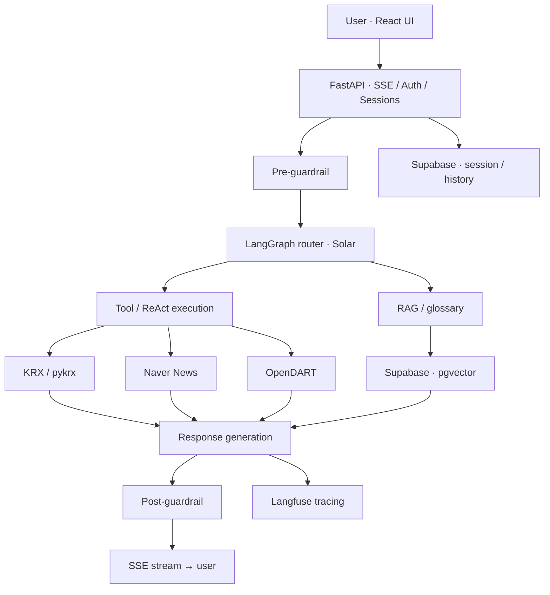

<div align="center">

# 📈 StockPilot

### A Tool-Using Financial Research Agent powered by Solar

**Ask about a stock. Let the agent find the evidence.**  
주가·뉴스·공시·금융 용어를 한 대화에서 조회하는 한국 주식 리서치 Agent


[Features](#features) · [Architecture](#architecture) · [Engineering](#engineering-decisions) · [Evaluation](#evaluation) · [Quick Start](#quick-start)

</div>

---

## Why StockPilot?

초보 투자자는 한 종목을 알아보기 위해 시세 사이트, 뉴스, 공시 시스템, 금융 용어 검색을 오갑니다. StockPilot은 **사용자 질문에 따라 필요한 데이터와 도구를 선택**하고, 근거를 모아 읽기 쉬운 설명으로 만드는 대화형 리서치 시스템입니다.

> **Not financial advice.** StockPilot은 참고용 정보 서비스를 지향하며 매수·매도 추천, 목표주가 예측, 손절·익절 판단을 제공하지 않습니다.

## Features

| User says | Agent does |
|:--|:--|
| “카카오 요즘 어때?” | KRX 시세, 관련 뉴스, 최근 공시를 조회해 요약 |
| “왜 올랐어?” | 직전 종목을 유지하고 실제 시세 방향과 질문의 전제를 확인 |
| “공시가 뭐야?” | Supabase pgvector에 저장된 금융 용어·문서 검색(RAG) |
| “추천해줘” | 투자 자문이 아닌 근거 기반 **후보 종목 스크리닝**으로 안내 |
| “삼성전자 매수 추천해줘” | 가드레일에 따라 직접적인 투자 조언을 제한 |

**Implemented:** 멀티턴 세션, 인증·대화 기록, Tool 호출, SSE 진행 이벤트, 오류 처리 및 클라우드 배포.

## Architecture



**Tech stack** · Solar Pro 3 · LangGraph · ReAct · FastAPI · SSE · Supabase PostgreSQL/pgvector · React/Vite · Docker · GCE · GitHub Actions

## Engineering Decisions

### 01 · Tool calling vs. RAG

변동하는 시세·뉴스·공시는 외부 API에서 조회하고, 비교적 정적인 금융 용어는 RAG에서 검색합니다. 이를 통해 **최신 사실을 기억에 의존해 만들어내는 문제**를 줄이도록 설계했습니다.

| Tool / component | Responsibility |
|:--|:--|
| \`get_stock_price\` | KRX/pykrx 시세 |
| \`get_news\` | Naver Search API 뉴스 |
| \`get_disclosure\` | OpenDART 공시 |
| \`lookup_glossary_term\` | 임베딩 기반 금융 용어 조회 |
| \`find_positive_news_stocks\` | 사전에 정의된 기준의 후보 스크리닝 |
| \`add_watchlist\` | 관심종목 기록 |

### 02 · Multi-turn context

“카카오 어때?” 다음에 “왜 떨어졌어?”라고 물으면 이전 종목을 이어받습니다. 다만 **사용자 질문의 상승·하락 전제가 실제 시세와 다르면 먼저 확인**하고, 종목이 모호하면 추가 정보를 요청하도록 했습니다.

### 03 · Service reliability

- SSE로 \`thinking → tool → response → glossary → done\` 순서의 진행 상황 전달
- 입력·출력 가드레일 및 민감정보 제한
- API timeout/retry, LiteLLM fallback, Langfuse trace
- Docker Compose + GCE 배포, GitHub Actions CI/CD

## Evaluation

프로젝트 내부 테스트와 시나리오 평가에서 기록한 수치입니다. **외부 고객 환경의 품질 또는 금융 분석 정확도를 의미하지 않습니다.**

| Internal check | Recorded result |
|:--|--:|
| Scenario prompts | **98 / 100** passed |
| Tool routing cases | **65 / 65** passed |
| RAG / glossary cases | **20 / 20** passed |
| Regression tests | **129 / 129** passed |
| Deployment smoke checks | **6 / 6** passed |

측정된 응답 시간은 첫 SSE 이벤트 평균 약 **1.2초**, 최종 응답 중앙값 약 **2.5초**였으며 외부 API 상태와 요청 종류에 따라 달라집니다.

[Evaluation runner →](data/scripts/eval_routing_100.py) · [Test suite →](tests/) · [Detailed records →](docs/README_BEFORE_PORTFOLIO_REFRESH.md)

## Quick Start

**Requirements:** Python 3.11 · Node.js · Supabase 설정 · 외부 데이터 API 인증정보

```bash
git clone https://github.com/Ai-pre/StockPilot.git
cd StockPilot

# Backend
uv sync
cp .env.example .env
# Fill environment values, create DB tables from data/supabase_schema.sql
uv run python data/scripts/ingest_rag.py
uv run uvicorn app.main:app --reload
```

```bash
# Frontend (separate terminal)
cd frontend
npm install
npm run dev
```

- FastAPI Docs: \`http://localhost:8000/docs\`
- Frontend: \`http://localhost:5173\`
- Containerized setup: \`docker compose up -d --build\`

**Do not commit keys.** 필요한 \`UPSTAGE_API_KEY\`, Naver/OpenDART, Supabase, JWT 등의 설정은 [\`.env.example\`](.env.example)에 정리돼 있습니다.

## Repository Guide

| Location | Content |
|:--|:--|
| [\`app/graph/\`](app/graph/) | LangGraph state, nodes, edges |
| [\`app/agents/\`](app/agents/) | Agent/ReAct implementations |
| [\`app/tools/\`](app/tools/) | Tool schemas, executor, registry |
| [\`app/repositories/\`](app/repositories/) | KRX, news, disclosure, RAG, storage |
| [\`app/api/\`](app/api/) | FastAPI routes, streaming, authentication |
| [\`frontend/\`](frontend/) | React UI |
| [\`tests/\`](tests/) | Unit & integration-related tests |
| [\`.github/workflows/\`](.github/workflows/) | CI and GCE deployment |
| [Original technical README](docs/README_BEFORE_PORTFOLIO_REFRESH.md) | API, environment, evaluation, deployment details |

## Limitations

- 뉴스와 공시의 최신성은 외부 API에 의존합니다.
- 스크리너의 탐색 universe는 제한적입니다.
- 내부 테스트 결과만으로 투자 판단 또는 일반 사용자 대상 신뢰도를 보장할 수 없습니다.
- 후속 과제: 종목 범위 확대, 오류 유형별 개선, 사용자 피드백 기반 서비스 검증

---

<div align="center">

**A financial research agent that checks the sources before answering.**

[Portfolio ↗](https://ai-pre.github.io/Ai-pre/) · [Project notes ↗](https://app.notion.com/p/39f06d3e452480999cf0c12bd245a112)

</div>